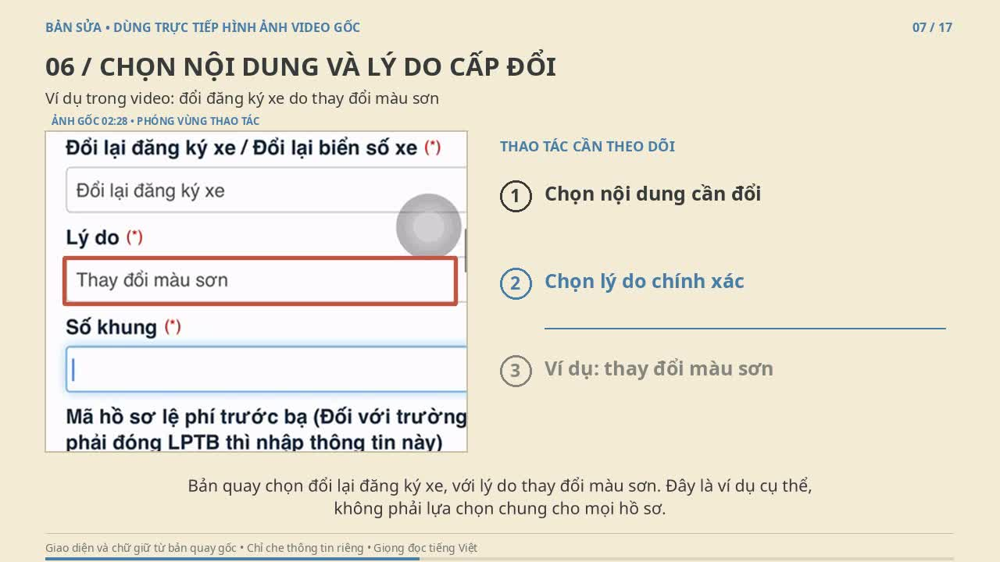

# Bản sửa dùng trực tiếp ảnh trong video gốc

[▶ Xem thử khoảng 50 giây](./xem-thu-ban-sua-anh-goc.mp4) · [⬇ Tải bản đầy đủ](./cap-doi-dang-ky-xe-anh-goc.mp4)

Bản đầy đủ dài 6 phút 42 giây, 17 phân cảnh, có giọng đọc tiếng Việt, phụ đề và khoảng dừng cuối cảnh.

Ảnh được trích trực tiếp từ video gốc, cắt phóng phần thao tác. Nét vẽ chỉ dùng để khoanh vùng. Thông tin tài khoản, OTP đăng nhập, thông tin liên hệ, số nhận dạng xe, mã hồ sơ và thông tin phiên được che trước khi dựng.

Đây là bản dùng các khung hình gốc có khoảng dừng, không phát lại toàn bộ chuyển động của nguồn. Kho không kèm ảnh nguồn hoặc dự án chỉnh sửa.

Đoạn xem thử gồm bước chọn lý do thay đổi màu sơn và đọc thông báo cuối nguồn. Thông báo nộp hồ sơ chưa đồng nghĩa đã hoàn tất cấp đổi. Trường hợp thay đổi màu sơn còn có yêu cầu kiểm tra thực tế xe theo quy định.
