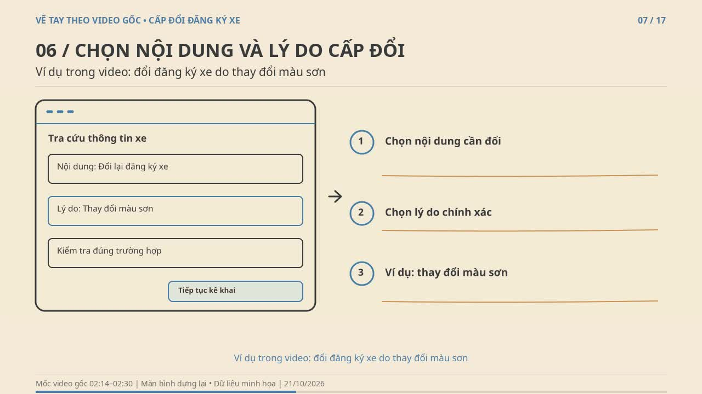

# Cấp đổi chứng nhận đăng ký xe — video vẽ tay theo bản quay

**[▶ Xem video](./cap-doi-dang-ky-xe-ve-tay.mp4)** · **[⬇ Tải MP4 trực tiếp](https://github.com/minhviminhvi95-sketch/Tr-L-AI/raw/refs/heads/main/videos/cap-doi-dang-ky-xe-ve-tay/cap-doi-dang-ky-xe-ve-tay.mp4)**

Bản dựng gồm **17 phân cảnh**, dài khoảng **6 phút 40 giây**, độ phân giải 1280×720, 24 fps, H.264/AAC. Có giọng đọc tổng hợp tiếng Việt, phụ đề theo đoạn và khoảng dừng ít nhất 4,5 giây sau lời đọc cuối mỗi cảnh.

Dựng dựa trên [IMG_8179.MP4 do người dùng cung cấp](https://github.com/minhviminhvi95-sketch/Tr-L-AI/releases/tag/V1.0.0), dài 265,9 giây. Giữ trình tự thao tác, chia thành 16 bước theo nguồn và thêm 1 cảnh lưu ý sau khi nộp. Màn hình được vẽ lại với dữ liệu minh họa để chữ dễ đọc và không lộ thông tin tài khoản, OTP hoặc hồ sơ thật. Đây không phải bản ghi thao tác trực tiếp trên giao diện mới nhất của cơ quan nhà nước.

## Tải các tệp đi kèm

| Tệp | Nội dung |
| --- | --- |
| [video-tung-buoc.zip](./video-tung-buoc.zip) | 17 tệp MP4 vẽ tay riêng theo phân cảnh |
| [giong-doc-tung-buoc.zip](./giong-doc-tung-buoc.zip) | Giọng đọc WAV riêng từng cảnh |
| [phu-de.srt](./phu-de.srt) | Phụ đề tiếng Việt |
| [bang-cat-theo-buoc.csv](./bang-cat-theo-buoc.csv) | Mốc thời gian từng bước trong nguồn và bản dựng |
| [KICH-BAN-VA-NGUON.md](./KICH-BAN-VA-NGUON.md) | Lời đọc, đối chiếu nguồn, ghi công |
| [du-an-chinh-sua.zip](./du-an-chinh-sua.zip) | Tranh, JSON vùng vẽ, dữ liệu thời gian và mã dựng; âm thanh ở gói WAV riêng |
| [tong-quan-17-canh.jpg](./tong-quan-17-canh.jpg) | Tổng quan các cảnh |
| [kiem-tra-ky-thuat.json](./kiem-tra-ky-thuat.json) | Kết quả kiểm tra định dạng, giữ hình và giải mã |
| [SHA256.txt](./SHA256.txt) | Mã kiểm tra tính toàn vẹn của MP4 |

## Nội dung cần hiểu đúng

- Ví dụ trong nguồn là **cấp đổi vì thay đổi màu sơn**, không phải đăng ký xe lần đầu hay cấp lại do mất giấy.
- Cuối nguồn xuất hiện lỗi trình duyệt **đồng thời** tin nhắn của cổng dịch vụ công thông báo đăng ký hồ sơ thành công. Bản dựng hướng dẫn lưu mã và tra cứu trước khi nộp lại; không diễn giải rằng chứng nhận đăng ký đã được cấp đổi xong.
- Trường hợp thay đổi màu sơn có yêu cầu đưa xe đến cơ quan đăng ký để kiểm tra theo quy định. Không mô tả trường hợp này là mọi khâu đều hoàn thành tại nhà.
- Tên dịch vụ, thành phần hồ sơ, thẩm quyền và phí, lệ phí phải theo yêu cầu hiện hành. Không suy ra miễn phí chỉ từ số tiền hiển thị trong nguồn.

Đối chiếu bổ sung nguồn chính thức ngày **21/10/2026**. Video gốc và các đoạn cắt chứa dữ liệu thật được giữ ngoài gói bàn giao công khai.
