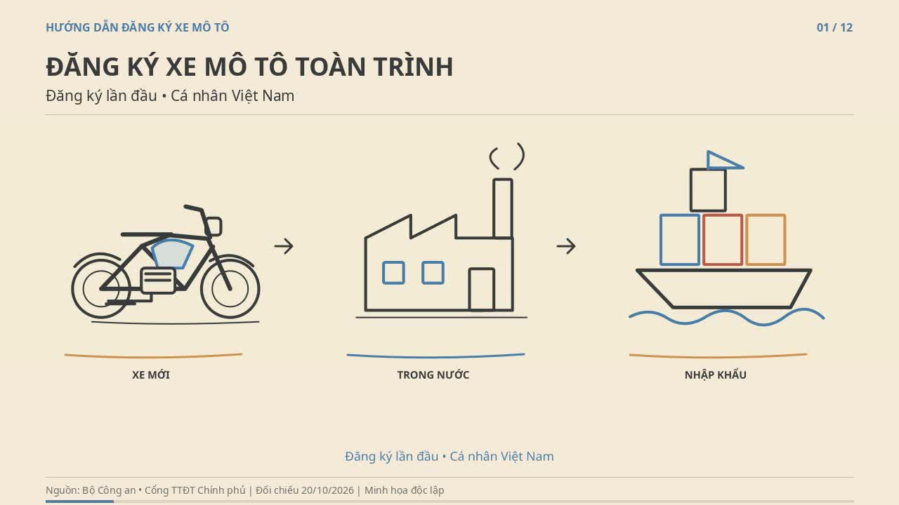

# Video vẽ tay: Đăng ký xe mô tô lần đầu trực tuyến toàn trình

**[▶ Xem video MP4](./dang-ky-xe-mo-to-toan-trinh.mp4)** · **[⬇ Tải trực tiếp](https://github.com/minhviminhvi95-sketch/Tr-L-AI/raw/refs/heads/main/videos/dang-ky-xe-mo-to-toan-trinh/dang-ky-xe-mo-to-toan-trinh.mp4)**

Video dài khoảng **5 phút 15 giây**, độ phân giải **1280×720**, 24 hình/giây, H.264/AAC. Gồm 12 phân cảnh có giọng đọc tổng hợp tiếng Việt, phụ đề và bảng nguồn cuối phim. Giữ hình ít nhất 4 giây sau lời đọc cuối mỗi cảnh.

Phạm vi: công dân Việt Nam đủ điều kiện đăng ký lần đầu xe mô tô mới **sản xuất, lắp ráp trong nước** hoặc **nhập khẩu**. Không hướng dẫn sang tên xe đã qua sử dụng.

Quy định và hướng dẫn được đối chiếu nguồn chính thức ngày **20/10/2026**. Video hướng dẫn độc lập, dùng hình minh họa; không phải video do cơ quan nhà nước phát hành. Cần kiểm tra lại văn bản và dịch vụ hiện hành nếu sử dụng ở thời điểm khác.

## Tệp đi kèm

| Tệp | Nội dung |
| --- | --- |
| [phu-de.srt](./phu-de.srt) | Phụ đề tiếng Việt |
| [giong-doc-tung-canh.zip](./giong-doc-tung-canh.zip) | 12 tệp WAV theo phân cảnh |
| [KICH-BAN-VA-NGUON.md](./KICH-BAN-VA-NGUON.md) | Toàn bộ lời đọc, nguồn pháp luật, ghi công và giấy phép |
| [du-an-co-the-chinh-sua.zip](./du-an-co-the-chinh-sua.zip) | Tranh, vùng vẽ, âm thanh, mã dựng và hướng dẫn chỉnh sửa |
| [kiem-tra-12-canh.jpg](./kiem-tra-12-canh.jpg) | Tổng quan hình ảnh 12 cảnh |
| [kiem-tra-ky-thuat.json](./kiem-tra-ky-thuat.json) | Kiểm tra định dạng, thời lượng, giữ hình và vùng chưa vẽ |

Video đã qua kiểm tra giải mã toàn bộ và có 12 chương điều hướng. Thời lượng tệp: 315,23 giây.

SHA-256 của MP4: `6ac46fe9e923966029c8d08d347ca9562d629b4d33729123e5abff6c63338c97`.
