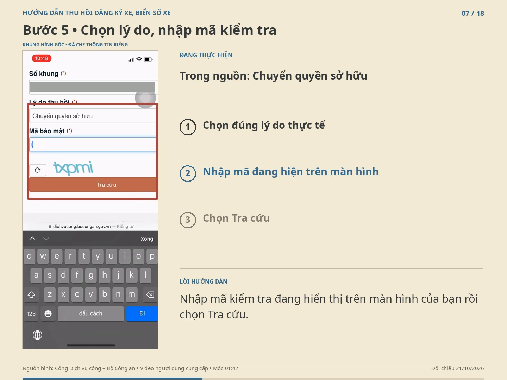

# Hướng dẫn thu hồi chứng nhận đăng ký xe, biển số xe

[Xem thử khoảng 70 giây](./xem-thu-thu-hoi-xe.mp4) · [Tải video đầy đủ](./thu-hoi-dang-ky-bien-so-xe.mp4)

Bản đầy đủ dài khoảng 10 phút 28 giây, 18 phân cảnh, giọng đọc tiếng Việt và phụ đề. Mỗi cảnh có ít nhất 5,5 giây giữ hình sau phần lời đọc. Giữ nguyên toàn bộ khung hình gốc; không cắt xén, không phóng vùng thao tác. Hướng dẫn và phụ đề đặt ở vùng bên ngoài. Các đoạn gõ nhập kéo dài, cuộn lặp và chờ tải được bỏ; giữ trích đoạn thao tác ngắn và dừng ở khung hình cần quan sát.

Thông tin cá nhân đã được che trước khi dựng: tên, ngày sinh, định danh, thông tin giấy tờ, địa chỉ cư trú, điện thoại, biển số, số khung, số máy, mã hồ sơ và tài khoản. Kho không kèm video gốc, ảnh nguồn hoặc dự án chỉnh sửa.

Ví dụ trong nguồn là **chuyển quyền sở hữu xe máy, dịch vụ trực tuyến một phần**. Có mã hồ sơ trên cổng chưa đồng nghĩa đã hoàn tất thu hồi. Phần cuối hướng dẫn nộp giấy tờ, biển số, điều kiện áp dụng bản chà và nhận kết quả; đây là phần bổ sung quy định, không giả lập rằng nguồn đã ghi lại các thao tác đó.

Đối chiếu đến 21/10/2026 với Thông tư 79/2024/TT-BCA và các sửa đổi, đặc biệt Thông tư 37/2026 và 62/2026. Chỉ miễn bản chà khi đáp ứng đủ điều kiện thu hồi điện tử và dữ liệu số hóa; không coi đây là miễn chung cho mọi hồ sơ.

- [Lời đọc và nguồn pháp luật](./KICH-BAN-VA-NGUON.md)
- [Giọng đọc riêng của 18 phân cảnh — ZIP](./giong-doc-tung-phan-canh.zip)
- [Phụ đề SRT](./phu-de.srt)
- [Nguồn video người dùng cung cấp](https://github.com/minhviminhvi95-sketch/Tr-L-AI/releases/tag/v2.0.0)

Nguồn giao diện: Cổng Dịch vụ công – Bộ Công an. Video hướng dẫn độc lập, không phải sản phẩm do cơ quan nhà nước phát hành. Giọng đọc Piper/VAIS-1000 (CC BY 4.0 theo thẻ mô hình), qua sherpa-onnx; phong cách nét bút theo srt-whiteboard-animation (MIT). Nguồn và ghi công chi tiết trong tệp kịch bản.
